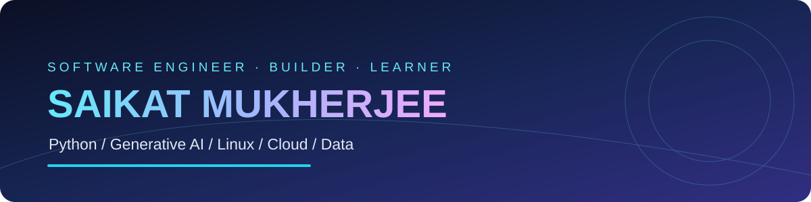

### ⚡ Engineering reliable systems & exploring intelligent software

**Python Engineering** · **Generative AI** · **Data Engineering** · **Linux & Infrastructure**

[Explore my repositories](https://github.com/saikatmukherjeelinux?tab=repositories) · [My GitHub profile](https://github.com/saikatmukherjeelinux)

---

## 👨‍💻 About Me

Hello! I'm **Saikat**, a software engineer with an interest in the entire lifecycle of modern software: understanding a problem, designing an architecture, implementing robust code, testing it, and operating it reliably. My technical interests connect **Python development**, **generative AI**, **data systems**, **Linux infrastructure**, and **developer automation**.

I enjoy exploring not only *what* a technology can do, but *how it works under the hood*. In AI, that means learning how tokenization, embeddings, retrieval, model inference, evaluation, and agent orchestration fit together. In backend engineering, it means thinking about clear APIs, maintainable modules, error handling, concurrency, performance, and observability. In infrastructure, it means understanding processes, networking, logs, scheduling, and the operational details that make systems dependable.

This profile is my **engineering notebook and growing project portfolio**. You'll find experiments, learning notes, interview preparation, and projects as I build and publish them. I prefer practical demonstrations with readable code, clear documentation, reproducible examples, and an explanation of engineering trade-offs.

### 🎯 Current areas of focus

| Domain | What I'm exploring |
| :--- | :--- |
| 🧠 **Generative AI** | LLM applications, prompt design, embeddings, RAG, AI agents, tool calling, evaluation, and guardrails |
| 🐍 **Python & Backend** | APIs, testing, concurrency, clean architecture, automation, and performance |
| 🐧 **Linux & Reliability** | Shell scripting, troubleshooting, scheduling, monitoring, logs, and operational workflows |
| 🗄️ **Data Engineering** | SQL, ETL/ELT, data validation, distributed processing, and PySpark |
| ☁️ **Cloud & Delivery** | AWS fundamentals, containers, CI/CD, deployment, and observability |
| 🧩 **Interview Practice** | Data structures, algorithms, SQL problems, and system-design fundamentals |

> **My approach:** Understand the fundamentals. Build something practical. Measure the result. Document what I learned.

---

## 🛠️ Technology Landscape

*These are areas of learning and engineering interest, not a claim of expert-level experience with every tool.*

### 🐍 Languages & Data

**Python** · **Bash** · **SQL** · **C++** · **PostgreSQL** · **MySQL**

### 🧠 AI & Backend

**LLMs** · **RAG** · **AI Agents** · **PyTorch** · **scikit-learn** · **FastAPI** · **Flask**

### ☁️ Cloud, Infrastructure & Tooling

**Linux** · **AWS** · **Docker** · **Git** · **GitHub Actions** · **Monitoring & Observability**

---

## 🚀 Project Roadmap

The projects below are **planned portfolio builds**, not claims of completed work. I'll link repositories and update statuses as they are published.

| Project | Engineering focus | Status |
| :--- | :--- | :--- |
| 🧠 **Production RAG Assistant** | Document ingestion, retrieval, citations, evaluation | 📋 Planned |
| 🤖 **Agentic Workflow Lab** | Tool calling, orchestration, retries, guardrails | 📋 Planned |
| 🗄️ **Data Engineering Pipeline** | ETL, data quality, SQL, PySpark | 📋 Planned |
| 🐧 **Linux Operations Toolkit** | Log analysis, system checks, shell automation | 📋 Planned |
| ⚙️ **API Reliability Starter** | Testing, rate limiting, logging, CI | 📋 Planned |
| 🧩 **DSA Interview Patterns** | Tested Python/C++ solutions, complexity notes | 📋 Planned |

**→ [Browse repositories](https://github.com/saikatmukherjeelinux?tab=repositories)**

---

## 📚 Learning in Public

<strong>🧠 Generative AI & LLM engineering</strong>

- Embeddings, vector search, chunking strategies, and retrieval evaluation
- Prompting, context management, tool calling, and agent design
- Model evaluation, observability, deployment, and reliability

<strong>🐍 Python & software engineering</strong>

- Python internals, decorators, generators, and concurrency
- Testing, exception handling, API design, and performance
- Maintainable architecture and practical automation

<strong>🐧 Linux, cloud & data</strong>

- Linux commands, shell pipelines, troubleshooting, and monitoring
- SQL, PySpark, ETL pipelines, and data quality
- Cloud fundamentals, containers, and CI/CD workflows

---

## 📈 GitHub Activity

For up-to-date contribution activity, visit my [GitHub contribution calendar](https://github.com/saikatmukherjeelinux). This README intentionally avoids third-party stats and tracking services.

**Open to learning, collaboration, and meaningful engineering conversations.**

