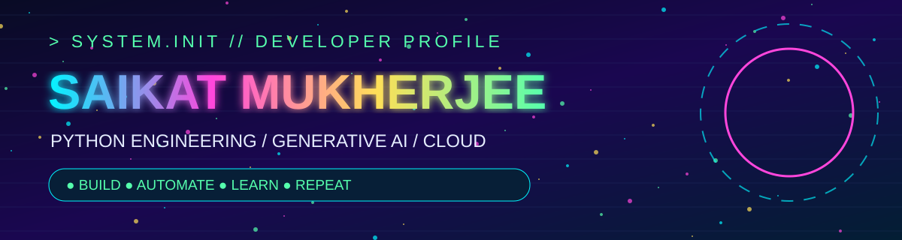
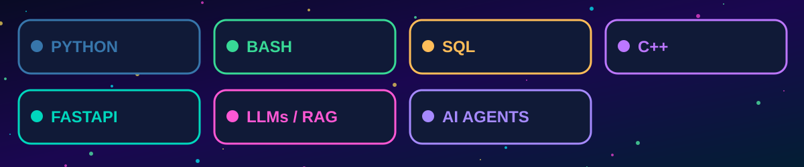
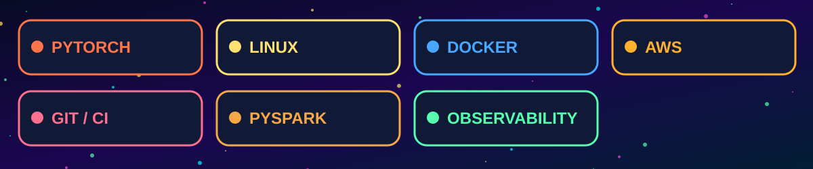

### ⚡ Engineering reliable systems. Exploring intelligent software.

**🐍 Python** &nbsp; • &nbsp; **🧠 Generative AI** &nbsp; • &nbsp; **☁️ Cloud** &nbsp; • &nbsp; **🐧 Linux** &nbsp; • &nbsp; **⚙️ Automation**

[**🚀 EXPLORE REPOSITORIES**](https://github.com/saikatmukherjeelinux?tab=repositories) &nbsp; • &nbsp; [**💻 GITHUB PROFILE**](https://github.com/saikatmukherjeelinux)

### 👋 Hello, I'm Saikat

> **I like understanding how things work, making them reliable, and turning complicated ideas into practical software.**

I'm a **software engineer** interested in the intersection of **Python development, Generative AI, backend systems, data engineering, cloud infrastructure, and developer automation**. What motivates me is the full journey of engineering: identifying a problem, breaking it into smaller pieces, building a thoughtful solution, testing it, observing its behavior, and improving it over time.

I enjoy going beyond high-level buzzwords. When learning about **LLMs and AI agents**, I want to understand the mechanics of **tokenization, embeddings, vector search, retrieval, context management, tool calling, orchestration, evaluation, and guardrails**. I am especially interested in how experimental AI workflows become **maintainable, testable, observable applications**.

On the software side, I explore **clean Python architecture, API design, SQL, concurrency, exception handling, performance, and automation**. On the infrastructure side, I am interested in **Linux internals, troubleshooting, process management, scheduling, logs, networking, monitoring, and operational reliability**. My data-engineering interests include **ETL pipelines, validation, distributed processing, and PySpark**.

I use GitHub as an evolving **engineering lab**: a place to publish projects, document experiments, practice interview problems, and share what I learn. I value **readable code, reproducible examples, useful documentation, and honest project status** over inflated claims.

| 🧠 **How I think** | 🔧 **How I build** | 📚 **How I learn** |
|:---|:---|:---|
| First principles and clear trade-offs | Modular code, testing and automation | Deep dives, experiments and notes |
| Reliability, maintainability and clarity | Logs, validation and observability | Practice, iteration and feedback |

*Technologies shown reflect areas of interest, learning and practice, not a claim of expert proficiency in every tool.*

### 🚀 Portfolio project roadmap

> 🟡 **Planned builds:** These are project ideas, not completed-project claims. Links will be added when repositories are published.

| Project | Focus | Stage |
|:---|:---|:---:|
| 🧠 **Production RAG Assistant** | Ingestion, chunking, embeddings, retrieval, citations and evaluation | 🟡 Planned |
| 🤖 **Agentic Workflow Lab** | Tools, retries, orchestration, safety and observability | 🟡 Planned |
| 🗃️ **Data Engineering Pipeline** | SQL, ETL, data quality and PySpark | 🟡 Planned |
| 🐧 **Linux Operations Toolkit** | Diagnostics, log analysis, shell scripting and automation | 🟡 Planned |
| ⚙️ **API Reliability Starter** | FastAPI, testing, rate limits, structured logs and CI | 🟡 Planned |
| 🧩 **DSA Interview Patterns** | Python/C++ implementations, tests and complexity analysis | 🟡 Planned |

[**✨ VIEW ALL REPOSITORIES →**](https://github.com/saikatmukherjeelinux?tab=repositories)

<b>🧠 Generative AI & LLM Engineering</b>

- Embeddings, vector search, RAG and hybrid retrieval
- Agent tools, workflow orchestration, evaluation and guardrails
- Prompt design, context management and deployment patterns

<b>🐍 Python, Architecture & Backend</b>

- APIs, type hints, concurrency, profiling and robust exception handling
- Testing, package structure, maintainability and performance

<b>🐧 Linux, Cloud & Data</b>

- Shell tools, processes, networking, monitoring and troubleshooting
- AWS, containers, CI/CD, SQL, pipelines and distributed data systems

<b>🧩 Interview Engineering</b>

- Data structures, algorithms, SQL challenges and system design
- Explainable solutions, edge cases and time/space complexity

---

### 🌈 Engineering principles

**⚡ Learn deeply** · **🛠️ Build practically** · **🧪 Test rigorously** · **📈 Improve continuously**

All visual assets are committed to this repository. No third-party image APIs, badge generators, tracking pixels, scripts or external fonts.
