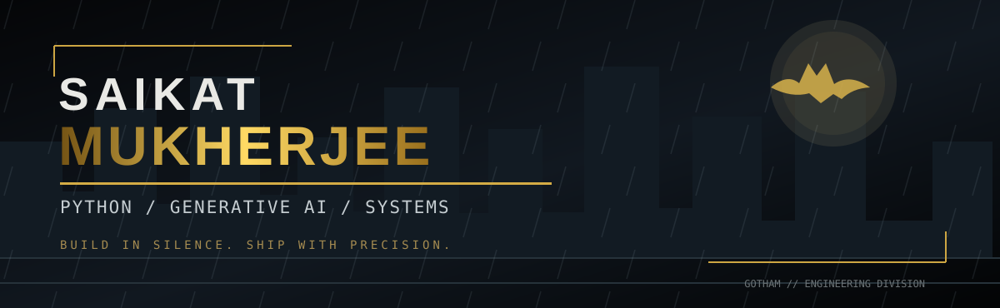
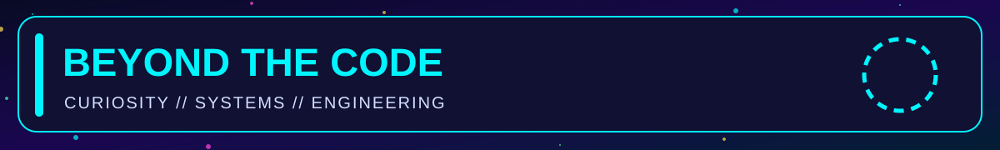
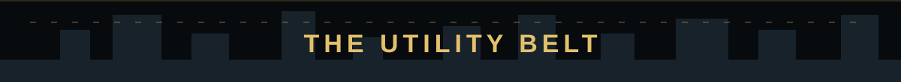
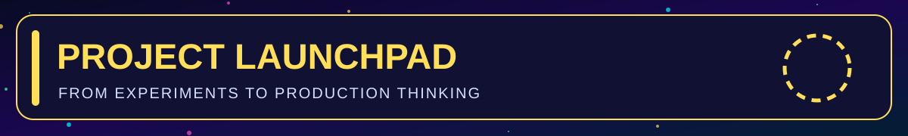
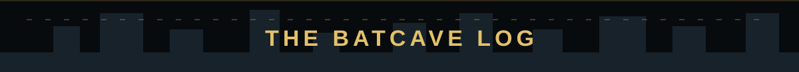

### 🦇 THE DARK KNIGHT OF DEBUGGING

**`SOFTWARE ENGINEERING`** &nbsp; • &nbsp; **`GENERATIVE AI`** &nbsp; • &nbsp; **`LINUX & CLOUD`**

**[EXPLORE MY REPOSITORIES](https://github.com/saikatmukherjeelinux?tab=repositories)**

> **MISSION STATEMENT**  
> Build dependable software. Understand systems from first principles. Turn complex ideas into clear, maintainable engineering.

### `IDENTITY // ENGINEER`

I'm **Saikat Mukherjee**, a software engineer interested in the intersection of **Python development, generative AI, data engineering, Linux infrastructure, cloud systems, and automation**. I enjoy exploring not only *how* software works, but also *why* it behaves the way it does under real-world constraints.

My engineering interests run from building readable, testable Python applications and APIs to investigating Linux processes, understanding distributed systems, designing reliable data pipelines, and experimenting with AI-assisted workflows. I care about the unglamorous details that make systems useful: observability, error handling, repeatability, maintainability, and sound operational decisions.

In **Generative AI**, I'm particularly interested in LLM application architecture, embeddings, retrieval-augmented generation (RAG), agentic tool use, context management, evaluation, and deployment. Rather than treating a model response as the entire product, I like thinking through ingestion, retrieval quality, guardrails, API design, monitoring, and the human workflows surrounding it.

I also spend time strengthening the fundamentals: **algorithms, SQL, Python internals, Linux troubleshooting, concurrency, system design, and machine-learning mathematics**. This profile is a working engineering notebook and a roadmap for practical projects, not a claim that every topic listed has already been mastered.

| DOSSIER | CURRENT FOCUS |
|:--|:--|
| **Core engineering** | Python, APIs, testing, reliability, automation |
| **Intelligent systems** | LLMs, RAG, AI agents, evaluation |
| **Data & infrastructure** | SQL, PySpark, Linux, cloud, observability |
| **Foundations** | DSA, system design, ML mathematics |
| **Philosophy** | Learn deeply. Build deliberately. Document clearly. |

### `EQUIPMENT // LANGUAGES & TOOLS`

**01 // Languages and databases**

`Python` · `Bash` · `SQL` · `C++` · `PostgreSQL` · `MySQL`

**02 // AI and backend**

`LLM Applications` · `RAG` · `AI Agents` · `PyTorch` · `scikit-learn` · `FastAPI` · `Flask`

**03 // Infrastructure and delivery**

`Linux` · `AWS` · `Docker` · `Git` · `GitHub Actions` · `Monitoring` · `Automation`

**04 // Data and architecture**

`PySpark` · `ETL` · `Distributed Systems` · `API Design` · `Testing` · `Observability`

> **Field note:** These are areas of interest and practice; the list is not a certification or proficiency claim.

### `MISSION BOARD // PORTFOLIO ROADMAP`

The following are **planned projects**, not completed deliverables. Links will be added when implementations are published.

| MISSION | ENGINEERING OBJECTIVE | STATUS |
|:--|:--|:--|
| **01 // RAG ASSISTANT** | Document ingestion, retrieval, grounded answers, evaluation | `PLANNED` |
| **02 // AGENT WORKFLOW LAB** | Tool calling, retries, orchestration, guardrails | `PLANNED` |
| **03 // DATA PIPELINE** | ETL, validation, quality checks, PySpark | `PLANNED` |
| **04 // LINUX OPERATIONS KIT** | Diagnostics, log parsing, CLI automation | `PLANNED` |
| **05 // RELIABLE API** | FastAPI, tests, rate limiting, CI | `PLANNED` |
| **06 // DSA PATTERN LIBRARY** | Interview patterns with tested Python/C++ solutions | `PLANNED` |

**[VIEW ALL REPOSITORIES](https://github.com/saikatmukherjeelinux?tab=repositories)**

<b>OPEN THE BATCAVE // CURRENT STUDY LOG</b>

- **AI engineering:** embeddings, vector search, RAG, agent design, evaluation, deployment.
- **Python engineering:** clean architecture, decorators, concurrency, performance, testing.
- **Infrastructure:** Linux internals, troubleshooting, monitoring, automation.
- **Data:** SQL, PySpark, pipelines, data quality, distributed processing.
- **Interviews:** algorithms, data structures, system design, practical exercises.

---

**NO EXTERNAL IMAGE SERVICES · NO TRACKERS · NO REMOTE BADGES**

