**BUILD QUIETLY. ENGINEER RELENTLESSLY.**

`PYTHON` &nbsp; `GENERATIVE AI` &nbsp; `LINUX` &nbsp; `AUTOMATION` &nbsp; `CLOUD`

I'm **Saikat Mukherjee**, a software engineer interested in the intersection of **reliable backend systems, practical AI, infrastructure, and automation**. I enjoy understanding how complex systems behave beneath the interface: how services communicate, how tasks are scheduled, how failures propagate, and how engineering teams can build software that is easier to operate.

My technical interests span **Python application development**, **generative AI and large language models**, **retrieval-augmented generation (RAG)**, **AI agents**, **data engineering**, and **Linux-based infrastructure**. I approach new technologies by learning their fundamentals, building small working systems, testing edge cases, and gradually evolving them into production-minded architectures.

I also enjoy troubleshooting: tracing logs, isolating dependencies, checking connectivity, interpreting errors, and making the results understandable to other engineers. This repository is a living record of what I'm learning and building, rather than a claim that every technology listed below is already a production specialization.

**Engineering principles:** observability over guesswork · clear interfaces · automation over repetition · security by design · simple solutions before unnecessary complexity.

| DOMAIN | TECHNOLOGIES & CONCEPTS |
|:--|:--|
| **Core engineering** | Python · SQL · Git · Bash · REST APIs · testing |
| **AI & LLMs** | Prompt engineering · embeddings · RAG · agents · evaluation |
| **Data systems** | Pandas · NumPy · PySpark · ETL concepts |
| **Infrastructure** | Linux · shell scripting · networking · monitoring · job scheduling |
| **Cloud & delivery** | AWS concepts · containers · CI/CD · automation |
| **Architecture** | Reliability · debugging · scalability · logging · security fundamentals |

### Projects

| PROJECT | MISSION | CORE STACK |
|:--|:--|:--|
| **RAG Knowledge Engine** | Retrieve documents, cite sources, evaluate answers | Python · embeddings · vector search |
| **AI Agent Operations Lab** | Build controlled tools, workflows, and traceable agent actions | Python · LLMs · tool calling |
| **Linux Incident Toolkit** | Collect diagnostics, parse logs, summarize infrastructure signals | Bash · Python · Linux |
| **Data Pipeline Workshop** | Build and validate batch ingestion and transformation | Python · SQL · PySpark |
| **API Reliability Monitor** | Track latency, failures, and service health | Python · APIs · monitoring |
| **Interview Algorithms Vault** | Document patterns, tests, and complexity analysis | Python · data structures |

<b>01 / CURRENT LEARNING PRIORITIES</b>

- LLM architecture, tokenization, attention, and inference fundamentals
- Retrieval systems: chunking, embeddings, reranking, evaluation
- Reliable Python services, concurrency, testing, and performance
- Linux internals, networking, logs, and incident response
- Distributed data processing and pipeline quality

<b>02 / HOW I APPROACH AN ENGINEERING PROBLEM</b>

1. Define the observable symptom and expected behaviour.
2. Establish the system boundaries and affected components.
3. Collect evidence from logs, metrics, configuration, and reproducible tests.
4. Isolate likely causes and test the smallest safe hypothesis.
5. Document findings, limitations, and next actions.

<b>03 / WHAT YOU WILL FIND HERE</b>

- Practical code examples with explanations and expected output
- Architecture notes and implementation trade-offs
- Automation utilities and infrastructure troubleshooting exercises
- AI experiments and engineering interview preparation

---

**THE WORK SPEAKS LOUDER THAN THE SIGNAL.**

`GOTHAM ENGINEERING DIVISION` · `BUILT IN THE OPEN`

